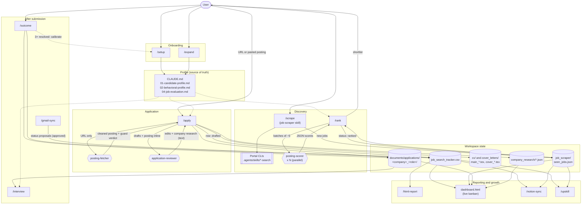
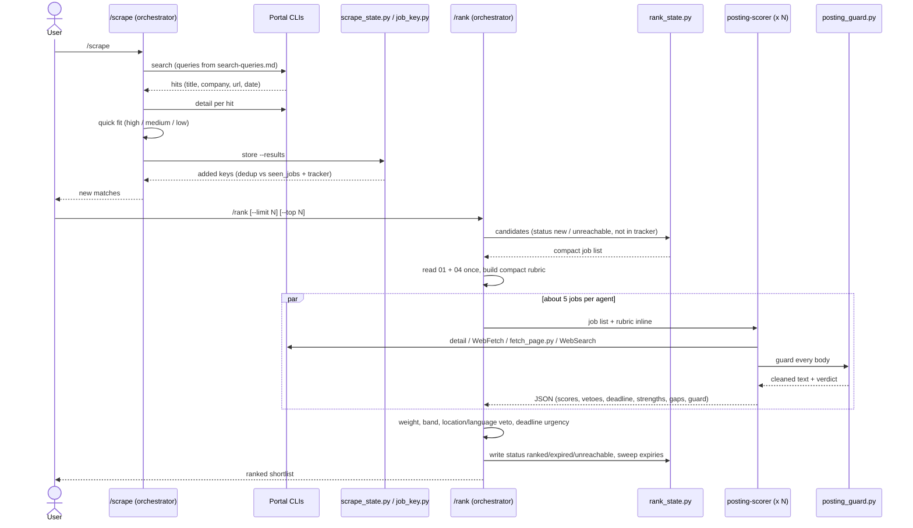
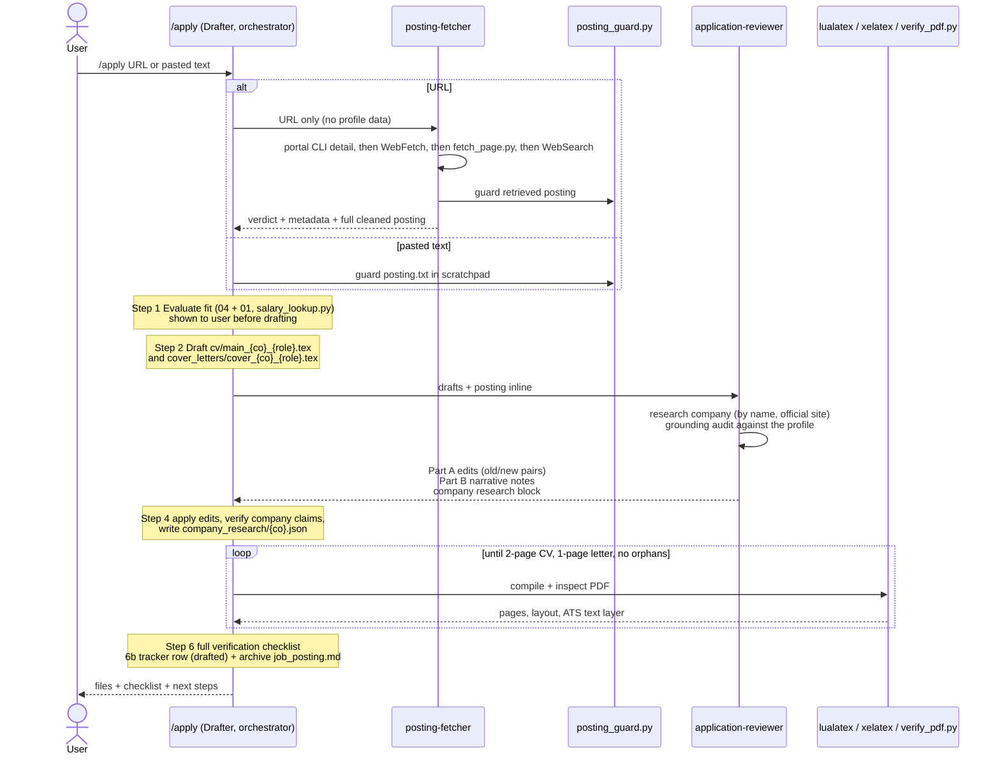
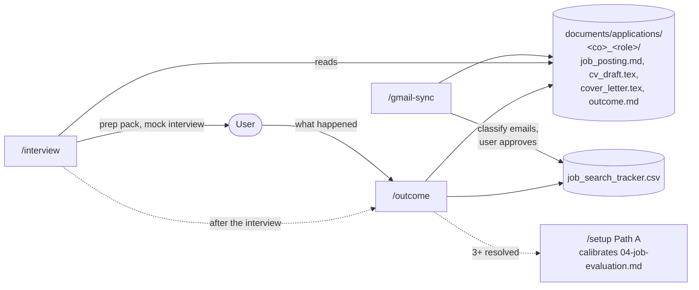

# Design: Agents and Data Flow

This document maps the agents in this workspace and how work flows from one to the next. The canonical behaviour of each piece lives in `.claude/` (see `AGENTS.md`). This file describes how the pieces connect and does not redefine them.

## Building blocks

| Kind | Where | What it is |
|------|-------|------------|
| **Orchestrator** | the main Claude Code session | Runs a slash command or skill, holds the candidate profile, writes every file |
| **Slash commands** | `.claude/commands/*.md` | Step-by-step workflows: `/setup`, `/expand`, `/rank`, `/apply`, `/interview`, `/outcome`, `/gmail-sync`, `/notion-sync`, `/html-report`, `/add-portal`, `/add-template`, `/reset` |
| **Skills** | `.claude/skills/*/SKILL.md` | `job-scraper` (`/scrape`), `job-application-assistant` (profile and method files `01`-`09`), `upskill` |
| **Subagents** | `.claude/agents/*.md` | `posting-fetcher`, `posting-scorer`, `application-reviewer`. They can read, search and fetch, but **cannot edit or write** |
| **Portal CLIs** | `.agents/skills/*-search/` | Per-board search and `detail` CLIs (LinkedIn, freehire and others), added with `/add-portal` |
| **Python tools** | `tools/`, `salary_lookup.py` | Deterministic helpers: `posting_guard.py`, `fetch_page.py`, `robots_check.py`, `scrape_state.py`, `rank_state.py`, `job_key.py`, `verify_pdf.py` |

### Trust boundary

Job postings are untrusted third-party text. Every component that touches a raw posting is either a read-only subagent or a Python gate:

- `tools/posting_guard.py` cleans every posting (hidden blocks, instruction-like lines, hidden URLs, invisible characters) before anyone reads it as content.
- Subagents have no Edit or Write tool. They return text, and the orchestrator decides what to write.
- URLs found inside a posting are never fetched. Only the user-supplied URL, or the employer's own site found by searching the company name, is fetched.

## System block diagram



Hexagons are subagents (read-only). Cylinders are files on disk. Only the orchestrator writes to them.

## Pipeline at a glance

```
 /setup ─► profile ─┐
 /expand ───────────┤
                    ▼
 /scrape ─► seen_jobs.json ─► /rank ─► shortlist ─► /apply ─► CV + cover letter
   │ (portal CLIs)              │ (posting-scorer x N)   │ (posting-fetcher,
   │                            │                        │  application-reviewer)
   │                            ▼                        ▼
   │                    status: ranked          tracker row: drafted
   │                                            documents/applications/<co>_<role>/
   │                                                     │
   │                                                     ▼
   │                                       /interview ─► prep pack
   │                                       /outcome   ─► tracker status + outcome.md
   │                                       /gmail-sync ► tracker status (approved)
   │                                                     │
   ▼                                                     ▼
 /upskill ◄──────────── tracker + ranked jobs ──► /html-report, /notion-sync
                                                     │
                       3+ resolved outcomes ─► /setup (calibrate 04-job-evaluation)
```

## Flow 1: Discovery (`/scrape` then `/rank`)



## Flow 2: Application (`/apply`), the drafter-reviewer loop



## Flow 3: After submission



Tracker status lifecycle (owned by `/outcome`, also written by `/apply` and `/gmail-sync`):

```
drafted ─► applied ─► interview ─► offer ─► hired
                │          │          └───► offer_declined
                │          └──────────────► rejected
                ├─────────────────────────► rejected / no_response
                └─────────────────────────► withdrawn
```

## Who reads and writes what

| Store | Written by | Read by |
|-------|-----------|---------|
| Profile files (`CLAUDE.md`, `01`-`09`) | `/setup`, `/expand`, `/apply` (new confirmed facts to `01`), `/interview` (approved STAR answers to `07`), `/reset` | every workflow |
| `job_scraper/seen_jobs.json` | `/scrape` (via `scrape_state.py`), `/rank` (via `rank_state.py`) | `/rank`, `/upskill`, `/notion-sync` |
| `job_search_tracker.csv` | `/apply` 6b, `/outcome`, `/gmail-sync` | `/rank` (exclusion), `/upskill`, `/html-report`, `/notion-sync` |
| `cv/`, `cover_letters/` | `/apply` | `/interview` (fallback), `/outcome` (archive) |
| `documents/applications/<co>_<role>/` | `/apply` 6b, `/outcome`, `/gmail-sync` | `/interview`, `/html-report`, `/setup` (calibration) |
| `company_research/*.json` | `/apply` Step 4 (from the reviewer's research block) | `/apply`, `/interview` |
| `gmail_sync/state.json` | `/gmail-sync` | `/gmail-sync` |
| `upskill/report-*.md` | `/upskill` | `/upskill` (diff against the last report) |
| `reports/application-dashboard.html` | `/html-report` | the user (browser) |
| `dashboard.html` (code, not data) | developer | reads `seen_jobs.json`, the tracker, the archive and `company_research/` live |

## Live dashboard (`dashboard.html`)

From the repo root run `python3 -m http.server 8000`, then open http://localhost:8000/dashboard.html. The page polls the state files every 20 seconds, so a `/scrape`, `/rank`, `/apply` or `/outcome` run shows up without a reload.

It is a read-only kanban. Each job is a card, and each column is a state:

| Column | Source |
|--------|--------|
| **Backlog** | `seen_jobs.json` entries with status `new`, `ranked` or `unreachable` that are not in the tracker. Sorted by priority: ranked by score (nearest deadline breaks ties), then unranked by scrape fit, then unreachable, then location/language vetoes last |
| **Drafted, Applied, Interview, Offer, Hired** | tracker `status` |
| **Closed** | tracker `rejected`, `no_response`, `offer_declined`, `withdrawn` |
| **Skipped / Expired** (toggle) | `seen_jobs.json` entries with status `skipped` or `expired` |

A tracker row is joined to its scraped entry on company + role (casefold), the same match `rank_state.py` uses, so a card keeps its `/rank` output after it moves to Applied.

Clicking a card opens a panel with everything recorded for that job:

- the overview: posting link, deadline, dates and portal
- the fit assessment from `/rank` (`posting-scorer`): score, verdict, location and language gates, guard verdict, strengths and gaps
- the tracker row: channel, contact, fit rating and the notes as a list
- the CV and cover letter (`.tex` and compiled `.pdf`)
- the application archive (`documents/applications/<co>_<role>/`), with `outcome.md` and the cleaned `job_posting.md` rendered inline
- the cached company research written from the `application-reviewer`
- the raw stored records

Every value is rendered as escaped text. Postings are untrusted, so no stored HTML is ever injected into the page. State changes stay with the commands: the board never writes.

## Design rules that shape the flow

1. **Single writer.** Subagents return text and the orchestrator writes. A poisoned posting cannot reach the filesystem through an agent.
2. **Gate before read.** Every posting, whether fetched, pasted or archived, goes through `posting_guard.py` before anyone reads it as content.
3. **Inline context.** The orchestrator passes drafts, postings and a compact rubric inline in the agent prompt, so subagents do not re-read profile files.
4. **Triage vs. evaluation.** `/rank` scores from posting text only. `/apply` Step 1 adds company research and is the authoritative fit evaluation.
5. **Grounding.** Every CV or cover-letter claim must trace to `01-candidate-profile.md`, `CLAUDE.md` or the master CV. Facts the user confirms mid-session are written to `01` in the same turn so later runs can use them.
6. **Deterministic state.** Keys, dedup, candidate selection and expiry sweeps go through Python tools rather than the model reading the whole state file.
7. **Human in the loop.** Fit is shown before drafting, `/gmail-sync` changes need approval, and `/reset` needs explicit confirmation.
