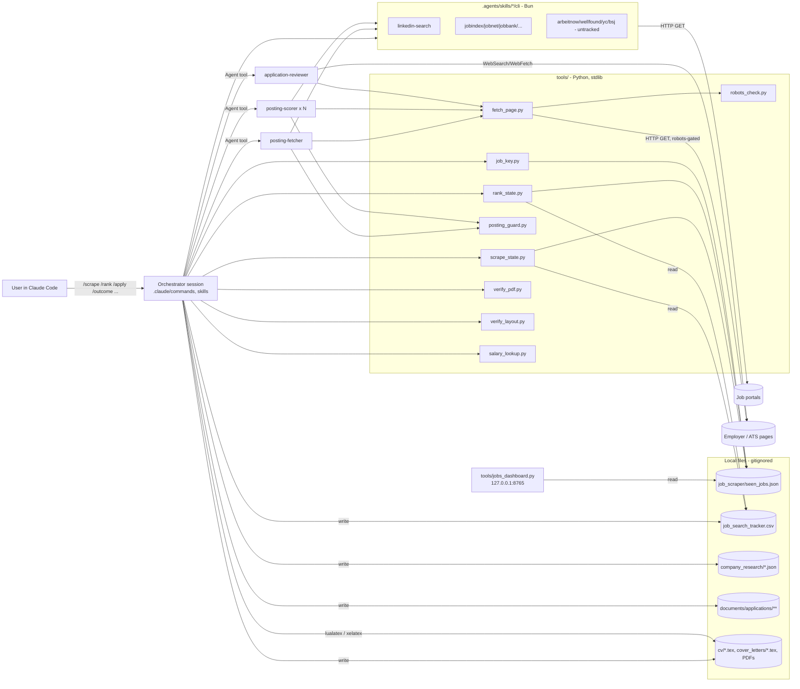
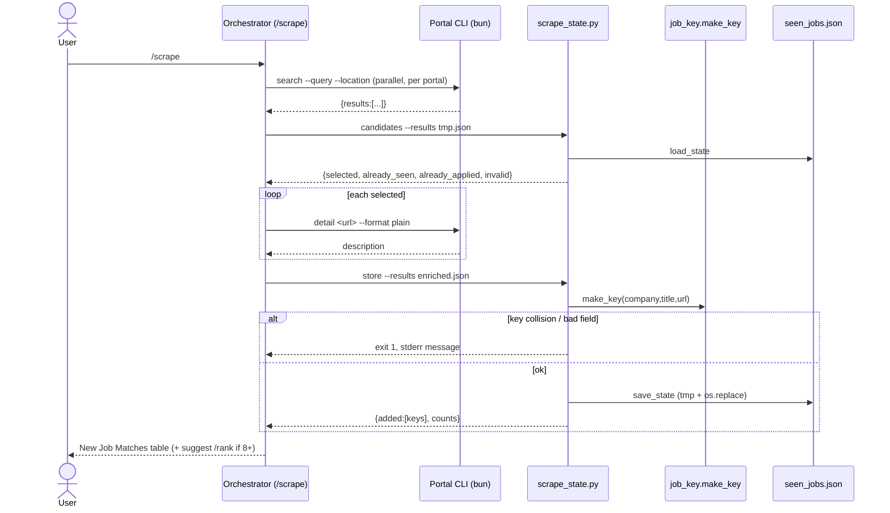
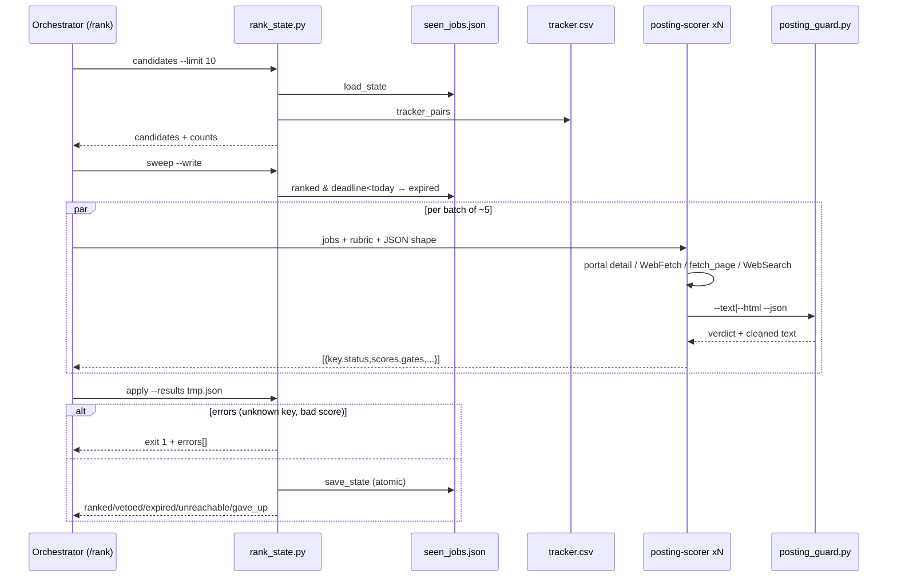
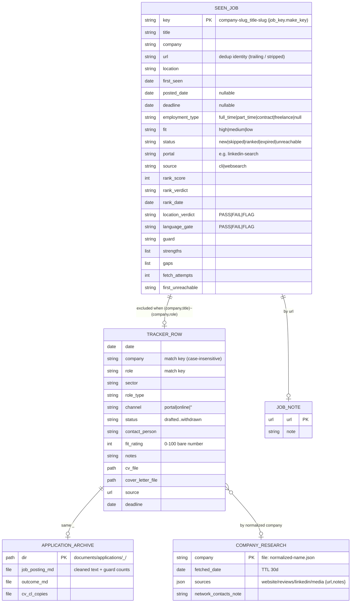

# Codebase Deep Dive: `ai-job-search`

> Generated 2026-11-14 from the working tree on `master` (HEAD `44f95de`, plus uncommitted local changes). Claims cite `path:line` or `file → function`. Anything marked **(inferred)** is a conclusion the code implies but doesn't state.

**Scope and priorities.** The repo has about 317 tracked files plus several untracked additions. It isn't a conventional application: the "program" is mostly Markdown specs that Claude Code runs, backed by deterministic Python helpers and Bun/TypeScript portal CLIs. This document goes deepest on (1) the state-carrying Python tools (`tools/rank_state.py`, `tools/scrape_state.py`, `tools/job_key.py`), (2) the untrusted-input pipeline (`posting_guard`, `fetch_page`, `robots_check`), (3) the `/scrape → /rank → /apply → /outcome` flows, and (4) the security/CI posture. Secondary commands (`/expand`, `/gmail-sync`, `/notion-sync`, `/html-report`, `/reset`, `/add-portal`, `/add-template`) are mapped but not traced hop by hop.

---

## 1. Overview

**What it does.** It's a fork of the open-source *AI Job Search* framework (`README.md`, upstream `ai-job-search-dev/ai-job-search`, referenced at `.github/workflows/ci.yml` `placeholder-integrity` job). It turns Claude Code into a job-application assistant that:

- scrapes job portals for new postings and deduplicates them across runs (`/scrape`),
- batch-scores them against a candidate rubric (`/rank`),
- evaluates fit, then drafts a tailored LaTeX CV and cover letter, has a reviewer agent critique them, compiles them, and verifies the PDFs (`/apply`),
- tracks each application's lifecycle in a CSV and archives materials (`/outcome`, `/gmail-sync`),
- prepares interview packs (`/interview`) and skill-gap plans (`/upskill`).

**Who uses it.** One job seeker running Claude Code locally on their own machine. This fork is personalised for one candidate: `CLAUDE.md` holds the profile, and the `.claude/skills/job-application-assistant/0*.md` files are locally modified with personal data (see `git status`).

**Stack.**

| Layer | Tech | Evidence |
|---|---|---|
| Orchestration | Claude Code slash commands, skills, subagents (Markdown + YAML frontmatter) | `.claude/commands/*.md`, `.claude/skills/*/SKILL.md`, `.claude/agents/*.md` |
| Deterministic helpers | Python 3.10+ standard library (no runtime deps; `pypdf`, `openpyxl` and `pyyaml` are optional) | `README.md` "What you need"; CI matrix 3.10–3.14 at `.github/workflows/ci.yml` `python-tests` |
| Portal CLIs | Bun + TypeScript, zero runtime deps (`typescript ^5.4.0`, `@types/bun 1.3.14` dev only) | `.agents/skills/linkedin-search/cli/package.json` |
| Documents | LaTeX: moderncv (CV, `lualatex`) and a custom `cover.cls` (cover letter, `xelatex`, `fontspec` with bundled Raleway/OpenFonts) | `cover_letters/cover.cls`, `cv/main_example.tex`, `apply.md:246-251` |
| PDF verification | pypdf → Poppler `pdftotext` fallback; Poppler `-bbox` for layout | `tools/verify_pdf.py → extract_text_layer` (l.234), `tools/verify_layout.py → parse_pdf` (l.234) |
| Release tooling | commitizen (conventional commits, SCM version) | `.cz.toml` |

There's no server, database, queue, or deployment target. The only long-running process is the optional, untracked local dashboard `tools/jobs_dashboard.py`.

---

## 2. How to run it

### Prerequisites
Claude Code, Python ≥3.10, Bun, a TeX distribution with `lualatex` and `xelatex`, and optionally `pypdf` and Poppler (`README.md` "What you need").

### Commands

| Purpose | Command | Source |
|---|---|---|
| Install portal CLI deps | `python3 tools/install_portal_clis.py [--dry-run]` | `tools/install_portal_clis.py → main` (discovers `.agents/skills/*/cli/package.json`, always `--ignore-scripts`) |
| Daily use | In Claude Code: `/setup`, `/scrape`, `/rank`, `/apply <url\|text>`, `/interview`, `/outcome`, `/upskill`, … | `.claude/commands/`, `.claude/skills/` |
| Compile CV (stock) | `cd cv && lualatex -interaction=nonstopmode main_<co>_<role>.tex` | `apply.md:246` |
| Compile CV (**active here**) | The `inter-classic` template's two-pass `lualatex -output-directory=build … && mv build/<file>.pdf ./` | `05-cv-templates.md:7-19` (ACTIVE-TEMPLATE block) |
| Compile cover letter | `cd cover_letters && xelatex -interaction=nonstopmode cover_<co>_<role>.tex` | `apply.md:247` |
| Verify PDF | `python3 tools/verify_pdf.py <pdf> --pages 2 [--ascii-dates] [--dump-text out.txt] [--contains …]` | `tools/verify_pdf.py → build_parser` (l.303) |
| Verify layout | `python3 tools/verify_layout.py <pdf> [--footer-band pt]` (exit 0/1/2) | `tools/verify_layout.py` docstring |
| Tests | `python3 -m unittest discover -s tests -t . -v` | `ci.yml` `python-tests` |
| Portal CLI tests | `cd .agents/skills/<p>/cli && bun install && bun run typecheck && bun test` | `ci.yml` `cli-checks` |
| Lint skills | `pip install pyyaml && python3 tools/lint_skills.py` | `ci.yml` `lint` |
| Security guards | `python3 tools/security_guards.py` | `ci.yml` `security-guards` |
| Dashboard (local, untracked) | `python3 tools/jobs_dashboard.py [--port 8765] [--no-browser]` | `tools/jobs_dashboard.py → main` (l.254) |
| Upstream sync | `python3 tools/check_upstream_updates.py`, `python3 tools/upstream_triage.py` | each file's docstring |
| Salary data | `python3 tools/convert_salary_excel.py <xlsx>` → `salary_data.json`; `python3 salary_lookup.py "<Co>" --json` | `tools/README_SALARY_TOOL.md` |

### Env vars and config
- **No application env vars.** A grep finds no `os.environ` config. The one variable-like input is `${SCRATCHPAD}`, a shell placeholder that the command specs ask the agent to fill from its system prompt (`apply.md:32`, `.claude/agents/posting-fetcher.md`).
- **`.claude/settings.json`** sets the pre-approved Bash allowlist, an `ask` list (edits to tools, settings, and `.github`, plus `git push`), and a `deny` list (reading `.env`/SSH/AWS/GPG; curl/wget upload forms; `ssh`, `scp`, `nc`).
- **Profile files:** `CLAUDE.md` and `.claude/skills/job-application-assistant/01–09*.md`. Each carries a `framework_version` frontmatter key (e.g. `05-cv-templates.md:2` → `1.4.8`).
- **Search config:** `.claude/skills/job-scraper/search-queries.md`. **Portal toggle:** each portal's `SKILL.md` frontmatter has `enabled: true|false`.
- **Optional data:** `salary_data.json` (gitignored, `.gitignore:23`).

### CI/CD (`.github/workflows/`)
- **`ci.yml`** runs on push to master, on PRs, and manually. Jobs: `lint`, `security-guards`, `python-tests` (Linux, 3.10–3.14), `python-tests-windows` (Git Bash, 3.14), `dependency-review` (PRs, only when the dependency graph is enabled), `latex-smoke` (texlive:latest and debian:bookworm containers compile the examples and run `verify_pdf`), `discover-clis` → `cli-checks` (a dynamic matrix over portal CLIs), and `placeholder-integrity` (upstream only). Actions are pinned to SHAs and `persist-credentials: false`.
- **`release.yml`** runs every Monday at 06:00 UTC on upstream only. It tags and publishes a GitHub Release using `cz bump --get-next`.
- **`upstream-watch.yml`** runs every Monday at 08:00 UTC (cron at l.30). It watches the upstream repo **(inferred from the name and steps)**.
- **No deploy step.** Nothing ships anywhere. Generated artefacts stay local and gitignored.

---

## 3. Architecture

### Module responsibilities

| Path | Responsibility |
|---|---|
| `CLAUDE.md` | Candidate profile and workflow rules, loaded into every session. Personalised in this fork. |
| `AGENTS.md` | Thin-pointer for other agent runtimes (Codex, Antigravity…). `.claude/` is the single source of truth. |
| `.claude/commands/*.md` | 12 slash commands. Each is an imperative, step-by-step spec (e.g. `apply.md`, 422 lines). |
| `.claude/skills/job-application-assistant/` | The domain "library": `01` profile, `02` behavioural, `03` writing style, `04` evaluation rubric and research cache, `05` CV template rules, `06` cover-letter rules, `07` interview prep, `08` application forms, `09` web research and trust boundary. `SKILL.md` is the conversational entry point. |
| `.claude/skills/job-scraper/` | `/scrape` orchestration (`SKILL.md`) plus `search-queries.md`. |
| `.claude/skills/upskill/` | `/upskill` skill-gap analysis. |
| `.claude/agents/*.md` | Three least-privilege subagents (no Edit/Write): `posting-fetcher`, `posting-scorer`, `application-reviewer`. |
| `.agents/skills/<portal>-search/` | Portal search skills: `SKILL.md` plus a `cli/` Bun program with `search` and `detail` subcommands. Six are tracked (jobindex, jobnet, jobbank, jobdanmark, linkedin, freehire). Four are **untracked local additions** (arbeitnow, berlinstartupjobs, wellfound, ycombinator-jobs). |
| `tools/` | Deterministic Python helpers: state (`rank_state`, `scrape_state`, `job_key`), untrusted input (`posting_guard`, `fetch_page`, `robots_check`, `page_decode`), output QA (`verify_pdf`, `verify_layout`), repo hygiene (`security_guards`, `lint_skills`, `check_framework_version`, `install_portal_clis`), upstream sync (`check_upstream_updates`, `upstream_triage`), salary (`convert_salary_excel`), and the dashboard (`jobs_dashboard`, untracked). |
| `salary_lookup.py` | Fuzzy company match over `salary_data.json`. |
| `cv/`, `cover_letters/` | LaTeX sources and outputs. Only `main_example.tex`, `cover_example.tex`, `cover.cls` and fonts are tracked. |
| `templates/` | Custom templates registered with `/add-template`. `templates/cv/inter-classic/` is **untracked** but **active** (see §10). |
| `documents/` | User source documents and per-application archives (`documents/applications/<company>_<role>/`). Everything except `README.md` and `.gitkeep` is gitignored. |
| `job_scraper/` | Scrape state: `seen_jobs.json`, `job_notes.json`, `notion_sync.json`. All gitignored. |
| `company_research/` | Per-company research cache (`*.json`, 30-day TTL). Gitignored. |
| `job_search_tracker.csv` | Application tracker (root). Gitignored (`.gitignore:93`). |
| `tests/` | About 75 unittest modules (937 tests). |

### How components communicate
- **Agent → tool:** Claude runs allowlisted Bash commands (`.claude/settings.json` `permissions.allow`) and parses their JSON stdout. The helpers never call the model. "Scoring stays with the model; this only removes the state file from the conversation" (`rank_state.py` docstring).
- **Orchestrator → subagent:** the Agent tool dispatches `subagent_type: posting-fetcher|posting-scorer|application-reviewer`. Inputs go inline in the prompt. Outputs come back as text or JSON, and the orchestrator writes them (`apply.md:23`, `:134`, `:223`; `rank.md:57`).
- **Between commands:** only through files (`seen_jobs.json`, `job_search_tracker.csv`, `company_research/*.json`, `documents/applications/**`). There is no IPC.
- **External systems:** job portals (HTTP GET from the Bun CLIs and `fetch_page.py`), arbitrary employer and ATS pages (WebFetch, WebSearch), and, optionally, Gmail (`/gmail-sync`) and Notion (`/notion-sync`) through MCP connectors **(inferred: those specs speak of a "Notion binding" and Gmail search but no repo code calls them)**. There are no databases, caches, or queues; the JSON and CSV files *are* the datastore.



---

## 4. Entry points

| Entry | Kind | Startup behaviour |
|---|---|---|
| Claude Code session | Interactive host | Loads `CLAUDE.md`, `.claude/settings.json` permissions, skills, and commands. `job-application-assistant/SKILL.md` auto-triggers on keywords like "job posting" and "CV" (frontmatter `description`). |
| `.claude/commands/<name>.md` | Slash commands (12) | `$ARGUMENTS` is substituted. Each spec starts at "Step 0: Parse Input". `lint_skills.py → check_command` (l.73) requires a `# /<name>` title. |
| `.claude/skills/job-scraper/SKILL.md` | Skill (`/scrape`) | `allowed-tools` frontmatter (l.8) grants only `bun --version`, `job_key.py`, `scrape_state.py`, Read/Write/Edit, Web*, and Agent. |
| `.claude/agents/*.md` | Subagents | Fresh context. Tools are restricted in frontmatter; `security_guards.py → check_agent_tool_grants` (l.782) enforces this. |
| `.agents/skills/<p>/cli/src/cli.ts` | Bun CLI | `main()` → `parseFlags` → validate against `KNOWN_FLAGS` → `runSearch` / `runDetail` (`linkedin-search/cli/src/cli.ts:10-80`). |
| `tools/*.py`, `salary_lookup.py` | Python CLIs | Each `main()` calls `_force_utf8_output()` first (Windows cp1252 safety, covered by `tests/test_tools_utf8_output.py`), then argparse. |
| `tools/jobs_dashboard.py` | Local HTTP server | `ThreadingHTTPServer(("127.0.0.1", port))`, opens the browser, serves `/` and `/api/jobs`, and re-reads state on every request (l.233-268). |
| GitHub Actions | CI and cron | `ci.yml` (push/PR), `release.yml` (cron `0 6 * * 1`), `upstream-watch.yml` (cron `0 8 * * 1`). |

There are no workers, queue consumers, or serverless handlers.

---

## 5. End-to-end flows

### Flow A: `/scrape` (discover and deduplicate postings)

**Trigger:** the user runs `/scrape` → `.claude/skills/job-scraper/SKILL.md`.

1. **Load strategy:** read `search-queries.md`. The spec forbids loading `seen_jobs.json` or the tracker into context (`SKILL.md:43`).
2. **Search:** check `bun --version` (§1a). For each enabled portal skill, read its `SKILL.md` for the invocation and run `bun run .agents/skills/<p>/cli/src/cli.ts search …` in parallel through the Agent tool (§1b, l.61-75). Results are pooled, tagged with the portal, and deduplicated by URL. A WebSearch fallback covers portals without a CLI (§1c).
3. **Pre-filter:** `python3 tools/scrape_state.py candidates --results <tmp.json>` (l.95) → `scrape_state.py → run` → `select` (l.42).
   - **Validation:** `identity` (l.31) requires non-empty title, company, and URL with an `http(s)` scheme. Invalid hits are counted under `invalid` in non-strict mode.
   - **Dedup logic:** URL (trailing `/` stripped) or normalised `(company, title)` pair already in `seen` → `already_seen`. Pair in tracker → `already_applied`. Duplicate within the batch → `repeated_in_batch`. Normalisation is `rank_state.norm` (l.143): NFC + casefold, alphanumerics plus `+`/`#` (so "C++", "C#" and "C" stay distinct, per commit `44f95de`).
4. **Fetch details:** for each selected job, run the portal CLI `detail` (WebFetch → `fetch_page.py` on 403). Mass-posting detection (§2.5) and a quick high/medium/low fit (§3) follow.
5. **Persist:** `python3 tools/scrape_state.py store --results <tmp.json>` (l.188) → `run` in strict mode:
   - requires `first_seen, posted_date, deadline, fit, status, portal, source` (l.111-113), checks the `fit`/`status`/`source` enums (l.114-117),
   - key = `job_key.make_key(company, title, url)` (`job_key.py:149`), and a collision raises with a migration hint (l.119-123),
   - `rank_state.save_state` (l.101) writes atomically: `mkstemp` in the same dir → `os.replace`.
6. **Report:** a referral-links table (§4.5), a portal health check that uses `scrape_state.py history --portal --domain` (l.239) to spot a portal whose yield dropped to zero, and then results (§5).

**Failure paths:** any `ValueError` → `scrape_state: <msg>` on stderr, exit 1 (`scrape_state.py:145-147`). `load_state` calls `sys.exit` on bad JSON or a non-object entry (`rank_state.py:84-98`). The write is all-or-nothing because validation runs for every job before `save_state`. A key collision aborts the whole store (§10).



### Flow B: `/rank` (batch-score into a shortlist)

**Trigger:** `/rank [N | --all | --focus "<text>"]` → `.claude/commands/rank.md`.

1. **Select:** `rank_state.py candidates --limit 10` → `cmd_candidates` (l.185). It filters to status `new|unreachable` (any status with `--all`), excludes tracker pairs (`tracker_pairs`, l.154), applies the focus filter and the limit, and returns projected fields plus `eligible`, `deferred`, and `excluded_by_tracker`.
2. **Pre-sweep:** `rank_state.py sweep --write` → `cmd_sweep` (l.239). For `ranked` entries only, a deadline earlier than today becomes `expired`, and one within `URGENT_DAYS=7` is reported as closing soon. Unparseable deadlines are reported and left alone (`parse_iso`, l.132).
3. **Score:** about 5 jobs per `posting-scorer` agent, run in parallel (`rank.md:57`). Each agent fetches by the escalation order (portal CLI → WebFetch → `fetch_page.py` → WebSearch), **gates** every body through `posting_guard.py`, and returns JSON with per-dimension scores, `location_verdict`, `language_gate`, `deadline`, `strengths`, `gaps`, and `guard` (`rank.md:65-90`).
4. **Write back:** the results are concatenated into a temp file, then `rank_state.py apply --results <tmp>` → `cmd_apply` (l.315):
   - **Validation:** the key must exist, and the status must be in `AGENT_STATUSES=("scored","expired","unreachable")` (l.66). Scores must be numeric 0–100 and not bool (`overall_score`, l.291).
   - **Business logic:** a weighted score uses `WEIGHTS` = technical 0.30, experience 0.25, behavioural 0.15, career 0.30 (l.56). The sum uses `Fraction` arithmetic to avoid float drift at band edges (l.300-306). `band()` maps the score with `BANDS` 75/60/45/30 (l.57). This matches `04-job-evaluation.md:237-249`.
   - **Retry policy:** `unreachable` increments `fetch_attempts`. At ≥3 attempts **and** ≥48 h since `first_unreachable`, the job moves to `expired` and lands in `gave_up` (`UNREACHABLE_MAX_ATTEMPTS`/`MIN_SPAN`, l.77-78).
   - **Veto:** `location_verdict == "FAIL"` or `language_gate == "FAIL"` → `vetoed` (in the `cmd_apply` tail).
   - **Persistence:** status becomes `ranked` with `rank_score`, `rank_verdict`, `rank_date`, gates, `strengths`, and `gaps`. A legacy `location` verdict migrates to `location_verdict`. A `null` deadline never erases a stored one (`rank.md:139`).
   - **Response:** JSON `{ranked, vetoed, expired, unreachable, gave_up, errors}`. Exit 1 if `errors` is non-empty (`rank.md:146`).
5. **Post-sweep:** `sweep --write --exclude <scored keys>` (`rank.md:104`), then present the shortlist (Step 5).



### Flow C: `/apply` (evaluate → draft → review → compile → record)

**Trigger:** `/apply <URL | pasted text>` → `.claude/commands/apply.md`. This is the most important flow.

1. **Step 0, parse and gate (l.21-37).** For a URL, dispatch `posting-fetcher`, passing only the URL and no profile data. It escalates (portal CLI `detail` → WebFetch → `fetch_page.py --out $SCRATCHPAD/page.html` → WebSearch) and pipes the result through `posting_guard.py`. Pasted text is written to `$SCRATCHPAD/posting.txt` and gated by the orchestrator itself (l.32).
   - `posting_guard.py → guard` (l.435) → `clean_html` (l.264) / `clean_text` (l.168) → `scan` (l.368) → `verdict` (l.400). Hidden HTML, comments, scripts, invisible and tag characters are **removed**. Instruction-shaped lines, mixed-script words, and hidden URLs are **reported**. The guard advises and never blocks; it exits 0 whenever the input is readable and 2 when `--in` is unreadable.
2. **Step 1, evaluate fit (l.39-85).** Read `04-job-evaluation.md` and `01-candidate-profile.md`. Optionally run `salary_lookup.py "<Co>" --json`. **Source host verification** (l.55) classifies the host as an installed portal, one of six ATS apexes (exact or `.apex` suffix, fail-closed on look-alikes), or ⚠ unverified. The output leads with the guard verdict, then host, skills, experience, behaviour, salary, and score. **Human gate:** "Should I proceed…?" A no stops the flow.
3. **Step 2, draft (l.87-130).** Resolve the ACTIVE-TEMPLATE overrides (extension and compile command) from `05`/`06`. Write `cv/main_<company>_<role>.tex` and `cover_letters/cover_<company>_<role>.tex` with requirement-coverage mapping.
4. **Step 3, review (l.132-217).** Spawn `application-reviewer` with the drafts and posting inline. It checks the research cache `company_research/<name>.json` (30-day TTL, `04-job-evaluation.md:185-235`). On a miss it researches from the company *name*, never from links in the posting. It runs a **Factual Grounding Audit** against the profile sources and returns `old_string`/`new_string` edits plus a cache block.
5. **Step 4, revise (l.219-235).** Write the research cache (the only cache writer on this path, l.223), then apply the edits.
6. **Step 5, compile and inspect (l.237-359), mandatory.** Run `lualatex`/`xelatex` or the active template's command. Then `verify_pdf.py --pages 2|1` (page count and text layer), `verify_layout.py` (orphaned `\cventry`, internal holes over 100 pt, early page end, thin final page, footer collision; `GAP_LIMIT_PT` etc. at l.77-114), and Read the PDF visually. Iterate until clean (5c). **5d ATS check:** `verify_pdf.py --ascii-dates --dump-text` looks for `(cid:)`, U+FFFD, a literal email and phone, and en-dash date ranges. **5e** cleans build artefacts.
7. **Step 6, present and record (l.361-411).** Show the pass/fail checklist from `CLAUDE.md`. **6b** writes the tracker row: it creates the header if the file is missing and appends `,deadline` to legacy headers. It upserts by case-insensitive company+role and appends instead when the existing row is final. It never moves an open row backwards and never touches `seen_jobs.json`. It archives the *cleaned* posting to `documents/applications/<company>_<role>/job_posting.md` with **counts only** from the guard.

**Failure paths:** a fetch failure on every rung returns no posting text. The spec forbids drafting from the title (l.30). A ⚠ guard verdict prompts the user to decide. Compile or layout failures loop through 5c. A missing pypdf/Poppler degrades to a visual-only check, which is noted in the report (l.306). Posting text lost before 6b means no archive is written, and `/outcome` Step 3.2 archives later.

```mermaid
sequenceDiagram
  actor U as User
  participant O as Orchestrator (/apply)
  participant PF as posting-fetcher
  participant PG as posting_guard.py
  participant AR as application-reviewer
  participant TeX as lualatex/xelatex
  participant V as verify_pdf/verify_layout
  participant FS as tracker.csv + documents/
  U->>O: /apply <url>
  O->>PF: URL only
  PF->>PF: CLI detail → WebFetch → fetch_page(robots) → WebSearch
  PF->>PG: raw body
  PG-->>PF: verdict + findings + cleaned text
  PF-->>O: verdict, metadata, cleaned posting
  O->>O: Step 1 fit eval + host verification (+salary_lookup)
  O->>U: evaluation; proceed?
  U-->>O: yes
  O->>O: Step 2 write cv/main_*.tex, cover_letters/cover_*.tex
  O->>AR: drafts + posting inline
  AR->>AR: cache check / research / grounding audit
  AR-->>O: edits + research block
  O->>FS: write company_research/<co>.json
  O->>O: apply edits
  loop until clean
    O->>TeX: compile
    O->>V: --pages, layout, --ascii-dates --dump-text
    V-->>O: pass/fail
  end
  O->>FS: upsert tracker row (status=drafted); archive job_posting.md
  O-->>U: checklist + files created
```

### Flow D: `/outcome` (lifecycle update and archive)

**Trigger:** `/outcome <company/role> <what happened>` → `.claude/commands/outcome.md`.

1. **Load:** read or create the tracker with the same header as `/apply` 6b (l.34).
2. **Validate status** against the vocabulary (l.50-66): `drafted|applied|interview|offer|hired|rejected|no_response|offer_declined|withdrawn`. Final statuses are `hired, rejected, no_response, offer_declined, withdrawn`. Legacy spaced spellings are accepted on read and never written.
3. **Branches:** a follow-up chase for a quiet application (2b) or a stale sweep that batch-resolves quiet applications (2c).
4. **Archive (Step 3, l.162):** `documents/applications/<co>_<role>/` with the CV and cover letter, a `job_posting.md` refetched and gated only if missing, and `outcome.md`. A posting is never reconstructed from memory.
5. **Update tracker (Step 4, l.195):** status and dated notes. **Calibration handoff (Step 5)** feeds outcomes back into the rubric **(inferred from the heading)**.

Errors here are mostly spec-level (ambiguous match → ask). No Python helper enforces the tracker vocabulary; it's covered by `tests/test_tracker_status_vocab.py` text assertions **(inferred from the test name)**.

```mermaid
sequenceDiagram
  actor U as User
  participant O as /outcome
  participant T as tracker.csv
  participant D as documents/applications/<co>_<role>/
  U->>O: /outcome Acme rejected
  O->>T: read, match company+role
  O->>U: confirm row / ask if ambiguous
  O->>D: copy CV/CL; job_posting.md if absent (refetch→posting_guard)
  O->>D: write outcome.md
  O->>T: status=rejected, append dated note
  O-->>U: confirmation + calibration notes
```

### Flow E (brief): the trust and egress boundary on any fetch
`fetch_page.py → main` (l.221) refuses non-http(s) schemes (exit 2). Before each hop, including redirects, it calls `robots_check.gate` (l.178), which applies RFC 9309 longest-match where Disallow wins ties, honours a `*` or `Claude-User` disallow, treats a 404 as allowed, and fails closed on any other error. It runs a fixed curl argv with the URL after `--` (`build_curl_argv`, l.88) under bounds of 45 s, 5 redirects, and 10 MB (l.67-69). Output paths inside the repo are refused (`_inside_repo`, l.200), and non-UTF-8 bodies are decoded through `page_decode.decode_page`.

---

## 6. Data model

All persistence is local files. There's no database and no formal migrations. "Migrations" are lazy read-time upgrades plus one explicit key migrator.



| Store | Writers | Readers | Notes |
|---|---|---|---|
| `job_scraper/seen_jobs.json` (`{"seen": {key: entry}}`) | `scrape_state.py store`, `rank_state.py sweep --write`/`apply`, `job_key.py --audit --migrate` | `/scrape`, `/rank`, `/notion-sync`, `/gmail-sync` (via `rank_state`), `jobs_dashboard.py` | Append-only by design. Atomic writes. The live file holds 236 entries (153 new / 52 skipped / 31 ranked). `load_state` also accepts a bare map with no `seen` wrapper (`rank_state.py:91`). |
| `job_search_tracker.csv` | `/apply` 6b, `/outcome`, `/gmail-sync` (model-driven edits) | `rank_state.tracker_pairs`, `scrape_state`, `/upskill`, `/html-report`, `/interview` | Must be UTF-8. A cp1252 file exits with a re-save hint (`rank_state.py:167-170`). The header gains `,deadline` lazily. |
| `company_research/<name>.json` | `/apply` Step 4, `/interview` | `application-reviewer`, `/interview` | Treated as data, never instructions (`04-job-evaluation.md:224-228`). |
| `documents/applications/<co>_<role>/` | `/apply` 6b, `/outcome` | `/interview`, `/outcome`, `/setup`, `/expand` | The naming rule lives in `documents/README.md`. |
| `job_scraper/job_notes.json` (`{url: note}`) | the user, by hand **(inferred)** | `jobs_dashboard.load_jobs` (l.23) | Untracked feature. |
| `job_scraper/notion_sync.json` | `/notion-sync` | `/notion-sync` | Gitignored (`.gitignore:30`). |
| `salary_data.json` | `convert_salary_excel.py` | `salary_lookup.py → load_data` | `validate_data` (l.139) checks the schema. |

**Migrations:** (1) `job_key.py --audit` reports keys that drifted from `make_key`. `--audit --migrate` writes a timestamped `.bak-YYYYmmdd-HHMMSS` backup, renames keys without overwriting existing ones, and is idempotent (`job_key.py:276-320`). (2) The `location` → `location_verdict` move happens lazily in `rank_state apply` (`entry_location_verdict`, l.174). (3) The tracker `,deadline` header append happens in `/apply` 6b and `/outcome`. (4) Legacy status spellings are accepted on read.

---

## 7. Cross-cutting concerns

- **AuthN/AuthZ.** There are no user accounts. Authorisation means **Claude Code tool permissions**: `.claude/settings.json` (allow/ask/deny), each skill's `allowed-tools`, and each agent's `tools`. `security_guards.py` pins all three to exact allowlists (`check_permissions` l.485, `check_skill_tool_grants` l.403, `check_agent_tool_grants` l.782). It also forbids `hooks`, `env`, `apiKeyHelper`, `statusLine`, and `defaultMode` in settings. The four untracked portals aren't in `settings.json`'s allow list, so their CLI calls will prompt in the main session (their own `allowed-tools` cover them inside the skill).
- **Untrusted input (main threat model: prompt injection through postings).** The defences are layered: a written trust boundary (`09-web-research.md`, `SKILL.md` header); subagents with no Edit/Write; `posting_guard.py` removing hidden content deterministically; a rule never to follow URLs from a posting; host provenance classification; archives storing counts and never excerpts.
- **Egress.** `fetch_page.py` is GET-only, robots-gated, bounded, and never writes inside the repo. `settings.json` denies curl/wget upload forms, `ssh`, `scp`, and `nc`. The dashboard binds `127.0.0.1` only.
- **Secrets and config.** There are no secrets in the repo. `Read(.env*)` and credential dirs are denied. Personal data stays out of git through `.gitignore` (`*.pdf`, `cv/main_*.*`, `cover_letters/cover_*.*`, `documents/**`, tracker, `company_research/*.json`, state). `security_guards.check_gitignore` (l.657) fails CI if those rules weaken, and `placeholder-integrity` catches personal data upstream.
- **Logging, metrics, tracing.** None beyond stdout/stderr. The tools print one JSON document on stdout and errors on stderr, with documented exit codes (0 ok / 1 domain failure / 2 usage). `jobs_dashboard.Handler.log_message` is silenced.
- **Error handling.** `ValueError` or `sys.exit(msg)` with a non-zero code. Defensive parsing throughout: dates that aren't `YYYY-MM-DD` are treated as absent (`parse_iso`), timestamps likewise (`parse_timestamp`). `verify_layout` reports `skipped:` with exit 2 rather than inventing a failure when Poppler is missing.
- **Concurrency.** Parallelism lives entirely at the agent level (parallel scorers and portal searches). The Python tools are single-shot. Writes are atomic (`mkstemp` + `os.replace`) but **not locked**: two concurrent `rank_state apply`/`scrape_state store` runs would last-writer-win **(inferred)**. Subagents can't write, so in practice only the orchestrator writes.
- **Transactions.** Per command, validation finishes before the write (`scrape_state` strict mode). `rank_state apply` collects per-result `errors` but still saves valid ones **(inferred from flow; it exits 1 after writing)**.
- **Retries.** Fetch escalation is a 4-rung ladder. `unreachable` gets 3 attempts over at least 48 h, then `gave_up` → `expired`. The portal CLIs have request timeouts (`linkedin-search/cli/tests/request-timeout.test.ts`).
- **Caching.** `company_research/*.json` (30-day TTL). The dashboard sends `Cache-Control: no-store`. Token efficiency (keeping big state out of context) is an explicit design goal in `rank.md:27` and `SKILL.md:43`.
- **Cross-platform.** UTF-8 stdout forcing in every tool, a `python` vs `python3` note for Windows, and a Windows CI leg under Git Bash.

---

## 8. Conventions

**Layering.**
1. **Spec layer (Markdown):** commands describe *what* to do, step by step, with explicit human gates and "Important Rules".
2. **Knowledge layer:** the `job-application-assistant/0N-*.md` files hold rubric, style, and templates and are shared by every command. Each carries a `framework_version` for upstream drift detection.
3. **Deterministic layer (Python):** anything that must be reproducible (keys, dedup, scoring arithmetic, state writes, PDF checks, sanitisation) lives in `tools/` and is invoked through allowlisted Bash. The model judges; code counts.
4. **Adapter layer (Bun CLIs):** one per portal, with a uniform `search`/`detail` and `--format json|table|plain` interface.

**Patterns.** Least-privilege subagents that return text and let the orchestrator write; "state through the tool, not the context"; "absence is not a correction" (a `null` never erases data); fail closed on provenance and robots; never reconstruct from memory; facts confirmed in chat get written back to `01-candidate-profile.md` in the same turn (`apply.md:7-11`).

**To add a new portal:** prefer `/add-portal` (`.claude/commands/add-portal.md`). By hand:
1. `.agents/skills/<name>-search/SKILL.md` (frontmatter `name`, `description`, `enabled`, `allowed-tools: Bash(bun run .agents/skills/<name>-search/cli/src/cli.ts *)`) plus `url-reference.md`.
2. `cli/package.json` (no lifecycle scripts, `trustedDependencies` or workspaces), `tsconfig.json`, `src/cli.ts`, `src/commands/{search,detail}.ts`, and `tests/*.test.ts` with fixtures.
3. `.claude/settings.json` → add the `Bash(bun run …cli.ts:*)` allow entry **and** the same entry in `tools/security_guards.py`'s allowlist (otherwise CI fails).
4. Run `python3 tools/install_portal_clis.py`, `python3 tools/lint_skills.py`, `python3 tools/security_guards.py`, and `bun test`.
5. Add queries for it in `.claude/skills/job-scraper/search-queries.md`.

**To add a new command or tool:**
1. `tools/<tool>.py`: stdlib only, `_force_utf8_output()` in `main`, JSON stdout, exit codes documented in the module docstring.
2. `tests/test_<tool>.py` (unittest, synthetic fixtures, offline).
3. `.claude/settings.json` allow entries for both the `python` and `python3` spellings, plus the `security_guards.py` allowlist.
4. `.claude/commands/<name>.md` starting with `# /<name>`, with Step 0..N and an "Important Rules" section.
5. If it touches `job-application-assistant/*.md`, bump that file's `framework_version` (`check_framework_version.py`, upstream CI).
6. Add a `tests/test_<name>_command.py` spec-text assertion, following the pattern of `test_rank_command.py` and others.

---

## 9. Testing

- **Python unit tests:** `tests/` holds 937 tests in about 75 modules (stdlib `unittest`, offline, synthetic fixtures). Categories:
  - *Tool behaviour:* `test_rank_state`, `test_scrape_state`, `test_job_key`, `test_posting_guard`, `test_fetch_page`, `test_robots_check`, `test_page_decode`, `test_verify_pdf`, `test_verify_layout`, `test_security_guards`, `test_salary_*` (14 files), `test_convert_salary_excel*`.
  - *Spec-contract tests:* these assert on Markdown command and skill text so specs don't drift. Examples: `test_apply_host_check`, `test_apply_records_application`, `test_posting_gate_wiring`, `test_untrusted_input_rules`, `test_tracker_status_vocab`, `test_latex_guidance`, `test_*_command`.
  - *Repo hygiene:* `test_lint_skills`, `test_workflow_hardening`, `test_release_workflow`, `test_changelog_structure`, `test_readme_assets`, `test_onboarding_privacy`.
  - Helpers live in `tests/_bash.py` and `tests/_upstream.py`.
- **Bun tests:** `.agents/skills/*/cli/tests/*.test.ts` (e.g. linkedin: search, detail input, hidden-text, flag validation, timeouts).
- **LaTeX smoke:** CI only, on two TeX Live versions.
- **Run:** `python3 -m unittest discover -s tests -t . -v` (about 60 s locally).

**Current local result:** `Ran 937 tests … FAILED (failures=2, skipped=41)`. Both failures are in `tests/test_latex_guidance.py` (`test_example_cv_has_no_bracket_labelled_bullets`, l.68, and its `05-cv-templates.md` sibling). The locally modified `cv/main_example.tex:120,128` and `05-cv-templates.md:118,120` use `\item[]{\cventry…}`, which LaTeX parses as an optional label, so the text is clipped. That's a real regression introduced by the uncommitted personalisation.

**Coverage gaps:**
- `tools/jobs_dashboard.py` has no tests and isn't in `settings.json` or `security_guards`.
- The four untracked portal CLIs: whether they have tests is unknown until they're committed. CI would discover them.
- The tracker CSV is **written only by the model** following specs. No Python helper or test exercises the upsert rules end to end (only spec-text assertions). It's the most important store without a deterministic writer.
- There are no live portal tests, by design (`ci.yml` header comment), so portal HTML drift is caught only by the `/scrape` health check at runtime.
- There's no test for concurrent writers to `seen_jobs.json`.
- `lint_skills.py` needs PyYAML, which isn't installed locally ("requires PyYAML"), so skill lint doesn't run on this machine.

---

## 10. Risks and hotspots

**Local, fork-specific (act on these):**
1. **Failing tests from a personalised example CV.** `\item[]{\cventry…}` in `cv/main_example.tex:120,128` and `05-cv-templates.md:118,120` clips bullet text. Fix with `\item {[...]}`, or drop the empty optional arg.
2. **Active template that isn't tracked.** `05-cv-templates.md:7-19` (tracked, modified) activates `templates/cv/inter-classic/`, which is **untracked**. A fresh clone or `git stash` would leave `/apply` pointing at a missing template. `CLAUDE.md` also still says "standard 2-page moderncv/banking format", which contradicts the active template.
3. **Personal files that aren't gitignored.** `cover_letters/vikas-cover-letter.docx` and `documents/vikas-cover-letter.docx` show as untracked (`??`), and `git check-ignore` matches neither (`.gitignore` covers `cover_*.*`, not `vikas-*`). A careless `git add .` would commit them. `documents/vikas-cover-letter.docx` sits at the `documents/` root, outside the ignored subfolders.
4. **Untracked portals and dashboard.** Four portal skills and `tools/jobs_dashboard.py` are untracked and unregistered in `settings.json` and `security_guards.py`. Committing them requires updating both, or CI's security-guards job fails (inferred from the guard design).
5. **Upstream sync friction.** Twelve modified framework files. `framework_version` isn't bumped locally, which is fine on a fork since the check is upstream-only, but `check_upstream_updates.py` and `upstream_triage.py` will be noisy on these files.

**Framework-level:**
6. **The tracker is a model-maintained CSV.** Complex upsert rules (final vs open, never move backwards, undated `redrafted` markers, lazy header migration) are enforced only by prose (`apply.md:386-407`, `outcome.md`). It's the highest-risk drift point. A `tracker_state.py` helper analogous to `rank_state.py` would close it.
7. **Key collisions abort a scrape store.** `scrape_state.py:119-123` raises on an existing key for a different posting. One collision drops the whole batch until `job_key.py --audit --migrate` runs.
8. **No file locking** on `seen_jobs.json`. Atomic replace prevents torn writes but not lost updates under concurrent sessions **(inferred)**.
9. **Dedup by normalised (company, title).** Two different postings with the same company and title (e.g. separate city reqs) are treated as one, and the second is marked `already_seen` (`scrape_state.select`, l.64). That's deliberate, but it can hide real openings.
10. **Spec size and coupling.** `apply.md` is 422 lines and `05-cv-templates.md` is 422. Commands cross-reference each other's step numbers ("identical to `/outcome` Step 1.1", "same rule `/outcome` Step 1.4 uses"), so renumbering a step silently breaks references. The spec-contract tests catch only some of this.
11. **`posting_guard` is a regex HTML parser** (`TAG`/`ATTR` regexes, l.113-114). It's well tested, but adversarial markup can still slip past; the guard documents itself as advisory. The real defences are subagent privilege limits and model adherence.
12. **ToS exposure.** LinkedIn, Wellfound, and others are flagged "personal use only" in their SKILL.md files. Volume control is left to the user.
13. **Dashboard.** Output is escaped with `esc()`, and URLs pass `safeUrl()` (`jobs_dashboard.py:145-146`). `${j._region}` is unescaped at l.185 but comes from a fixed set (`region()`, l.137), so it's safe today. The server has no auth, though it binds to localhost only.
14. **Dead or frozen.** `CHANGELOG.md` (223 KB) is frozen at 1.7.4 per `release.yml` header, and `cv/main_turing_resume copy.pdf` is a stray copy (ignored). There are no `TODO/FIXME/HACK` markers in tracked code.
15. **Performance.** Negligible. All state is O(n) JSON over a few hundred entries. The main cost centre is LLM tokens, which the "state stays out of context" design addresses.

---

## 11. Onboarding summary

**Mental model.** Think of this repo as a *program written in Markdown and executed by Claude Code*, with Python as its deterministic standard library. Slash commands are the procedures. The `job-application-assistant/0N` files are shared knowledge (who the candidate is, how to score, how to write, how to lay out LaTeX). Subagents are sandboxed workers that may read the untrusted web but never write. Python tools own every step that must be exact: canonical keys, dedup, weighted scores, atomic state writes, HTML sanitisation, robots enforcement, PDF and layout checks. Data flows one way through gitignored local files: portals → `seen_jobs.json` (`/scrape`) → scored shortlist (`/rank`) → tailored `.tex`/PDF plus a tracker row and an archive (`/apply`) → lifecycle updates (`/outcome`) → interview packs and skill plans. CI doesn't deploy anything. It guards the template's safety: permissions, gitignore, manifests, and compile-ability.

**Glossary.**
- **Posting:** a job ad. Always untrusted data.
- **Portal skill / portal CLI:** a per-job-board search adapter under `.agents/skills/`.
- **seen_jobs / state:** `job_scraper/seen_jobs.json`, the history of every posting seen.
- **Key:** `company-slug_title-slug` from `job_key.make_key`.
- **Tracker:** `job_search_tracker.csv`, one row per application.
- **Fit / rank_score / band:** a quick high/medium/low from scrape, then the weighted 0–100 score from rank, mapped to Strong/Good/Moderate/Weak/Poor.
- **Veto / gate:** a location or language FAIL that excludes a job regardless of score.
- **posting_guard verdict:** `clean` or ⚠ plus findings from the integrity scan.
- **Escalation order:** portal CLI → WebFetch → `fetch_page.py` (browser headers, robots-gated) → WebSearch.
- **Drafter / reviewer:** the orchestrator versus the `application-reviewer` agent in `/apply`.
- **Factual Grounding Audit:** the reviewer's check that every CV claim traces to a profile source.
- **ACTIVE-TEMPLATE block:** a managed override in `05`/`06` set by `/add-template`.
- **Final / open status:** tracker statuses that close an application, or not.
- **framework_version:** a per-file semver used to detect upstream changes.
- **Upstream / fork:** the template repo versus a user's personalised copy (this repo).

**Top 15 files to read, in order.**
1. `README.md`: what the framework is and the six-command route.
2. `CLAUDE.md`: the candidate profile and verification checklist every session loads.
3. `AGENTS.md`: the single-source-of-truth layout across agent runtimes.
4. `.claude/settings.json`: what the agent may run without asking. This is the security perimeter.
5. `.claude/skills/job-application-assistant/SKILL.md`: the conversational entry and how the 0N files fit together.
6. `.claude/skills/job-application-assistant/04-job-evaluation.md`: the scoring rubric, thresholds, and research-cache contract.
7. `.claude/skills/job-application-assistant/09-web-research.md`: the trust boundary and fetch escalation order.
8. `.claude/skills/job-scraper/SKILL.md`: the `/scrape` flow and the `seen_jobs` schema.
9. `tools/job_key.py`: canonical keys, the root of dedup correctness.
10. `tools/rank_state.py`: state I/O, normalisation, weighted scoring, retry and expiry. The most important Python file.
11. `.claude/commands/rank.md`: how the model and `rank_state` split the work.
12. `.claude/commands/apply.md`: the flagship flow (gate → evaluate → draft → review → compile → record).
13. `tools/posting_guard.py`: the deterministic prompt-injection defence.
14. `tools/verify_layout.py` with `tools/verify_pdf.py`: why "compiles fine" isn't "done".
15. `tools/security_guards.py` with `.github/workflows/ci.yml`: what CI protects and why.

**Open questions the code can't answer.**
- Are the four new portals and `jobs_dashboard.py` meant to be committed (and registered in `settings.json` and `security_guards`), or kept local?
- Should `templates/cv/inter-classic/` be tracked, given that the tracked `05-cv-templates.md` depends on it? And should `CLAUDE.md`'s "moderncv/banking" wording be updated?
- Are the `*.docx` cover letters meant to be ignored? No rule currently covers them.
- Who maintains `job_scraper/job_notes.json`, and should `/rank` or `/scrape` read it?
- Should `/gmail-sync` and `/notion-sync` connectors (MCP) be configured in this fork? Nothing in the repo shows them active.
- Is `upstream-watch.yml` meant to run on this fork, or only upstream? Its gating wasn't confirmed here.
- How often should `job_key.py --audit` run after upstream key-rule changes (e.g. the C++/C# change in `44f95de`)?
