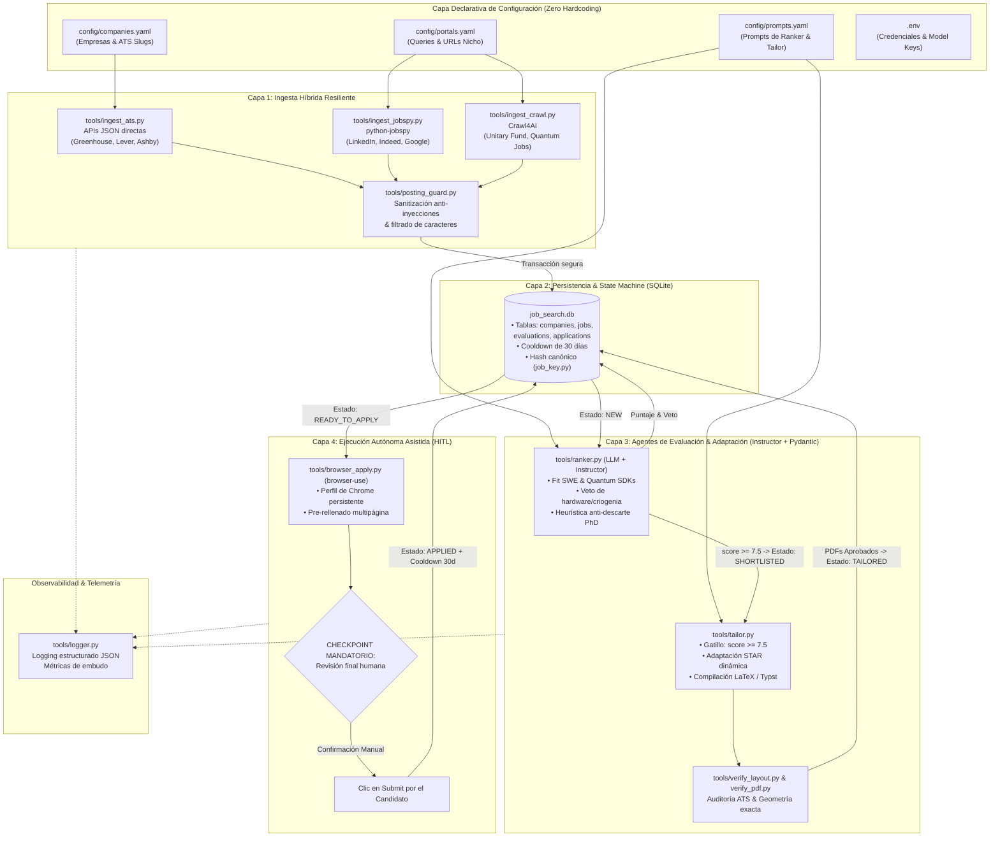

# Plan Técnico Definitivo: Arquitectura Multi-Agente Desacoplada con Enfoque Human-in-the-Loop (HITL) para `ai-job-search`

## 1. Resumen Ejecutivo y Visión Arquitectónica

El proyecto `ai-job-search` evoluciona hacia una plataforma de grado de producción diseñada para un objetivo estratégico específico: **conseguir el primer empleo como Ingeniero de Software con especialización en Computación Cuántica (Quantum Software Engineer)**.

### Realidad del Mercado y Desafíos Técnicos
1. **Mercado Fragmentado y Heterogéneo:** Las vacantes de computación cuántica se dividen entre grandes empresas tecnológicas (IBM, Google, Microsoft) y un ecosistema de startups nicho (Rigetti, IonQ, PsiQuantum, SandboxAQ, Xanadu, Zapata AI, Algorithmiq, Classiq), publicadas en múltiples ATS (Greenhouse, Lever, Ashby, Workday) y bolsas de trabajo especializadas (Quantum Jobs, Unitary Fund).
2. **El "Falso Filtro de PhD":** Gran cantidad de ofertas cuánticas incluyen en sus descripciones un requisito de *"PhD in Physics/CS"* heredado por plantillas estándar de Recursos Humanos. Sin embargo, los puestos de desarrollo de software (SDKs, compiladores, cloud runtimes, algoritmos de optimización) requieren habilidades de ingeniería de software sólida (Python, C++, arquitecturas distribuidas, buenas prácticas) antes que doctorados en física teórica. El evaluador debe discriminar esta casuística para evitar descartes erróneos.
3. **Filtro de Exclusión de Hardware/Laboratorio:** Veto automático e inmediato a vacantes de laboratorio físico, criogenia, fotónica experimental, alineación láser o fabricación de semiconductores.
4. **Enfoque Human-in-the-Loop (HITL) Estricto:** Prohibición expresa de envío masivo o *auto-apply* ciego. El sistema automatiza el rastreo, la sanitización, el rankeo, la adaptación tipográfica de CV/carta y el pre-rellenado de formularios complejos en el navegador, **deteniéndose de forma obligatoria e ineludible antes del botón de envío (*Submit*)** para validación humana.

---

## 2. Diagrama de Arquitectura Global



---

## 3. Especificación Técnica Detallada por Capas

### Capa 0: Configuración y Desacoplamiento Total
Ninguna URL, empresa, consulta o prompt debe residir dentro del código Python:
- `config/companies.yaml`: Lista estructurada de empresas target con su proveedor ATS (`greenhouse`, `lever`, `ashby`), slug oficial, dominio y tags (`quantum_software`, `algorithms`, `compilers`).
- `config/portals.yaml`: Parámetros de búsqueda para agregadores generalistas (`python-jobspy`) y URLs/selectores para scraping de portales nicho sin API pública (`Crawl4AI`).
- `config/prompts.yaml`: Templates en formato Jinja2/string estructurado para el Ranker y el Tailor, facilitando la iteración de prompts sin alterar la lógica de negocio.
- `.env`: Claves de API (`OPENAI_API_KEY`, `ANTHROPIC_API_KEY`, `GEMINI_API_KEY`), configuraciones de timeout y rutas de perfiles de navegador.

---

### Capa 1: Ingesta Híbrida y Normalización
Objetivo: Capturar ofertas del mercado con cero fragilidad ante cambios de diseño web (evitando selectores CSS/XPath rígidos).

1. **APIs JSON Directas (`tools/ingest_ats.py`):**
   - Consume endpoints públicos no autenticados:
     - Greenhouse: `https://boards-api.greenhouse.io/v1/boards/{slug}/jobs?content=true`
     - Lever: `https://api.lever.co/v0/postings/{slug}?mode=json`
     - Ashby: `https://api.ashbyhq.com/posting-api/job-board/{slug}`
   - Retorna datos limpios en milisegundos sin requerir emulación de navegador.
2. **Agregadores Generalistas (`tools/ingest_jobspy.py`):**
   - Wrapper sobre `python-jobspy` para LinkedIn, Indeed, Glassdoor y Google Jobs.
   - Búsquedas con rate-limiting y retries exponenciales (`tenacity`).
   - Consultas target: `"Quantum Software Engineer"`, `"Quantum SDK"`, `"Quantum Compiler"`, `"Software Engineer Python Qiskit"`.
3. **Extracción en Markdown con Crawl4AI (`tools/ingest_crawl.py`):**
   - Para bolsas nicho (ej. Unitary Fund Job Board, Quantum Jobs) y startups con portales custom.
   - Renderiza Single-Page Applications (SPA) y convierte el contenido relevante a Markdown limpio para su posterior evaluación.
4. **Escudo de Sanitización (`tools/posting_guard.py`):**
   - Toda descripción pasa obligatoriamente por este filtro para neutralizar ataques de *prompt injection*, texto oculto (CSS `display:none`) y caracteres Unicode cero-espacio antes de guardarse en la base de datos.

---

### Capa 2: Persistencia y Máquina de Estados (SQLite)
Objetivo: Garantizar consistencia transaccional (ACID), trazabilidad del ciclo de vida y evitar colisiones de archivos planos.

#### Máquina de Estados Canónica:
```
  [Ingesta] ──► NEW
                 │
      ┌──────────┴──────────┐
      ▼                     ▼
 SHORTLISTED             IGNORED (Veto o score < 7.5)
      │
      ▼
   TAILORED (CV & Carta generados y auditados)
      │
      ▼
READY_TO_APPLY
      │
      ▼
   APPLIED (Confirmación tras revisión humana HITL)
```

#### Modelo de Datos (`job_search.db` en `tools/db.py`):
- `companies`: Control de empresa, dominio, `cooldown_until` (30 días tras postulación) y notas.
- `jobs`: Clave canónica generada con `tools/job_key.py` (hash SHA-256 de URL/empresa/título normalizados), portal origen, modalidad remota/presencial, salario, descripción cruda y estado actual (`status`).
- `evaluations`: Puntaje numérico (0.0 a 10.0), desglose de fit en SWE y Quantum, indicador de veto, razón de veto, evaluación del PhD y fortalezas/brechas.
- `applications`: Archivos generados (rutas a PDFs validados), fecha de postulación, modo de envío y notas de feedback.

---

### Capa 3: Agentes de Evaluación y Adaptación (`Instructor` + `Pydantic`)

#### 1. Agente Evaluador Semántico (Ranker - `tools/ranker.py`)
Utiliza `instructor` para forzar salidas JSON con tipado estricto validadas por `Pydantic`.

```python
from pydantic import BaseModel, Field
from typing import List, Literal, Optional

class QuantumJobEvaluation(BaseModel):
    is_software_role: bool = Field(
        ...,
        description="True si el rol es de ingeniería de software, desarrollo de SDKs, algoritmos, compiladores, backend o cloud."
    )
    is_experimental_hardware: bool = Field(
        ...,
        description="True si el rol requiere trabajar con láseres, criogenia, fabricación física de chips o hardware experimental."
    )
    phd_requirement_analysis: Literal["not_required", "generic_hr_boilerplate", "strict_scientific_research"] = Field(
        ...,
        description="Determina si el PhD es un requisito excluyente real de física teórica o si es texto genérico de HR para un rol de software."
    )
    software_fit_score: float = Field(..., ge=0.0, le=10.0)
    quantum_fit_score: float = Field(..., ge=0.0, le=10.0)
    overall_score: float = Field(..., ge=0.0, le=10.0)
    
    should_veto: bool = Field(
        ...,
        description="True si es hardware experimental, ubicación incompatible o investigación teórica de frontera no accesible a SWE."
    )
    veto_reason: Optional[str] = None
    
    matched_skills: List[str]
    missing_keywords: List[str]
    tailoring_recommendations: List[str]
```

##### Matriz de Ponderación y Reglas de Negocio del Ranker:
- **Prioridad Máxima:** SDKs cuánticos (Qiskit, PennyLane, Cirq), Compiladores (LLVM/QIR), Algoritmos híbridos (VQE, QAOA), Backend en Python/C++/Rust, Computación en la nube para computadores cuánticos.
- **Regla del PhD:** Si `phd_requirement_analysis == 'generic_hr_boilerplate'` y `is_software_role == True`, **no se aplica veto** y se califica en base a competencias de software y herramientas cuánticas.
- **Veto Automático Inmediato:** Puestos de laboratorio físico, criostatos, óptico-mecánica, fabricación en sala limpia (*cleanroom*), o exigencias de autorización de defensa nacional no elegibles.

#### 2. Agente Adaptador de Documentos (Tailor - `tools/tailor.py`)
- **Gatillo determinista:** Se activa únicamente cuando `overall_score >= 7.5` y el estado pasa a `SHORTLISTED`.
- **Inyección dinámica de logros STAR:** Lee el perfil maestro (`profile/master_profile.yaml`) y reorganiza los proyectos cuánticos y habilidades de software para resaltar exactamente las `matched_skills` de la vacante.
- **Control de Calidad Determinista:**
  - `tools/verify_layout.py`: Comprobación geométrica que impide desbordes de página (CV en 2 páginas exactas, carta en 1 página exacta).
  - `tools/verify_pdf.py`: Extracción con `pdftotext` para validar que el texto sea 100% procesable por los parsers de ATS.
- Actualiza el estado a `TAILORED` y posteriormente a `READY_TO_APPLY`.

---

### Capa 4: Ejecución Asistida HITL (`browser-use` / Playwright)
Objetivo: Eliminar el esfuerzo repetitivo de rellenar formularios multipágina manteniendo control total sobre el proceso de postulación.

```
[Vacante en estado READY_TO_APPLY]
               │
               ▼
   [browser-use inicia con Perfil Persistente de Chrome]
   • Carga cookies de sesión (LinkedIn, Google, cuentas guardadas)
   • Analiza el DOM del ATS mediante visión/LLM (resiliente a cambios de maquetación)
   • Rellena datos personales, enlaces de GitHub/LinkedIn y preguntas estándar
   • Sube el PDF adaptado y validado en Capa 3
               │
               ▼
   ┌────────────────────────────────────────────────────────────┐
   │            CHECKPOINT MANDATORIO: STOP PRE-SUBMIT          │
   │  • El navegador se detiene de forma obligatoria.           │
   │  • Se emite alerta sonora y notificación interactiva en CLI.│
   │  • El usuario revisa manualmente cada campo completado.    │
   │  • El usuario hace clic manual en el botón definitivo.      │
   └────────────────────────────────────────────────────────────┘
               │
               ▼
   [Registro Transaccional en SQLite]
   • Estado de la vacante actualizado a APPLIED
   • Registro de timestamp exacto y snapshot de la postulación
   • Activación de Cooldown de 30 días para la empresa en companies
```

> [!IMPORTANT]
> **Seguridad y Garantía Ética:** `browser-use` tiene prohibido por diseño resolver CAPTCHAs de forma desatendida o ejecutar el click final de envío. Esto garantiza inmunidad total ante postulaciones erróneas, respuestas inadecuadas en preguntas de visado y bloqueos de plataformas.

---

### Capa 5: Observabilidad y Telemetría (`tools/logger.py`)
- **Logging estructurado:** Emisión de logs en formato JSON legible por máquinas y formateado en terminal con librerías estándar / `structlog`.
- **Métricas de Embudo (Funnel Tracking):**
  - Número de vacantes ingestadas por portal/ATS.
  - Vacantes descartadas y desglose por motivo (`veto_hardware`, `veto_location`, `low_score`).
  - Tasa de vacantes que superan el umbral (`score >= 7.5`).
  - Registro de tiempos de respuesta en APIs y LLMs con manejo de retries exponenciales.

---

## 4. Estado de Implementación y Plan de Trabajo (Roadmap)

### Estado Actual del Repositorio (Al 16 de Noviembre de 2026)
- [x] Entorno virtual `.venv` configurado en Python 3.12 con dependencias clave.
- [x] Motor de persistencia SQLite `tools/db.py` implementado con soporte de transacciones, estados y cooldown.
- [x] Suite de pruebas automatizadas `tests/test_db_state.py` ejecutada y aprobada (3/3 tests passing).
- [x] Conector ATS inicial `tools/ingest_ats.py` consumiendo endpoints JSON de Greenhouse, Lever y Ashby.
- [x] Herramientas legacy conservadas: `tools/posting_guard.py`, `tools/job_key.py`, `tools/verify_layout.py`, `tools/verify_pdf.py`.

---

### Sprints de Finalización

#### Sprint 1: Arquitectura Declarativa y Observabilidad (Completar Fundación)
- [x] Crear `config/companies.yaml`: migrar y enriquecer el listado de empresas cuánticas (SandboxAQ, Rigetti, IonQ, PsiQuantum, Xanadu, Zapata AI, IBM Quantum, Classiq).
- [x] Crear `config/portals.yaml`: configuración de queries y endpoints para agregadores.
- [x] Crear `config/prompts.yaml`: centralizar templates para evaluación (Ranker) y adaptación (Tailor).
- [x] Implementar `tools/logger.py`: sistema de logging estructurado con contadores de métricas de embudo.
- [x] Añadir alias canónico `NEW` a `tools/db.py` para sincronizar nomenclaturas.

#### Sprint 2: Completar Ingesta Híbrida (Agregadores y Portales Nicho)
- [x] Implementar `tools/ingest_jobspy.py`: módulo de ingesta para LinkedIn, Indeed y Google Jobs con retries y rate-limiting.
- [x] Implementar `tools/ingest_crawl.py`: módulo con Crawl4AI para portales de empleos cuánticos sin API estructurada (Unitary Fund, Quantum Jobs).
- [x] Integrar todos los canales de ingesta al pipeline unificado que sanitiza mediante `tools/posting_guard.py` y persiste en `job_search.db`.

#### Sprint 3: Agente Evaluador Semántico (Ranker con Instructor)
- [x] Instalar e integrar `instructor` en `.venv`.
- [x] Implementar `tools/ranker.py` con el modelo Pydantic `QuantumJobEvaluation`.
- [x] Calibrar el prompt de evaluación en `config/prompts.yaml` para resolver el falso filtro de PhD y priorizar roles de Quantum Software/SDKs frente a física experimental.
- [x] Implementar comando CLI para evaluar vacantes en estado `NEW` y transicionar a `SHORTLISTED` o `IGNORED`.

#### Sprint 4: Agente Adaptador de Documentos (Tailor con Score >= 7.5)
- [x] Crear la plantilla `profile/master_profile.example.yaml`; el perfil real `profile/master_profile.yaml` se genera al primer uso y está en `.gitignore`.
- [x] Implementar `tools/tailor.py`: selecciona vacantes `SHORTLISTED` con `score >= 7.5`, ajusta las secciones de CV y carta según las palabras clave de la oferta.
- [x] Conectar la verificación automática con `verify_layout.py` y `verify_pdf.py`, dejando los PDFs validados en `documents/applications/<company>_<job>/` y pasando el estado a `READY_TO_APPLY`.

#### Sprint 5: Ejecución Asistida HITL con `browser-use`
- [x] Implementar `tools/browser_apply.py` utilizando Playwright / `browser-use` apuntando al perfil persistente de usuario.
- [x] Implementar el checkpoint interactivo mandatorio que detiene la ejecución antes del botón final de *Submit*.
- [x] Registrar la confirmación humana en SQLite actualizando el estado a `APPLIED` e iniciando el cooldown de 30 días para la empresa.

#### Notas de implementación (Sprints 4 y 5)

- `tools/tailor.py` es determinista: solo reordena contenido del perfil maestro y descarta habilidades que el perfil no respalda. Ajusta fuente y márgenes hasta que el CV entre en una página y luego corre `verify_pdf` y `verify_layout`.
- `tools/browser_apply.py` usa Playwright directo (Chrome headed, perfil dedicado) en lugar de `browser-use`: el relleno es por reglas, sin LLM. Nunca hace clic, no resuelve CAPTCHAs y deja sin tocar selects, textareas, radios y checkboxes. `APPLIED` solo se registra si el usuario escribe `applied` tras enviar el formulario él mismo.
- Flujo: `python tools/ranker.py` -> `python tools/tailor.py` -> `python tools/browser_apply.py --list` -> `python tools/browser_apply.py --job-id N`.

#### Operación y robustez

- **Esquema versionado:** `PRAGMA user_version` y migraciones ordenadas en `tools/db.py` (`MIGRATIONS`). Una base antigua se actualiza sola al abrirla.
- **Respaldos:** `python tools/db.py --backup` copia la base a `backups/` y conserva las 5 más recientes. Las ingestas y `ranker.py --reevaluate` respaldan solas antes de escribir (como máximo una vez por hora y por 10 minutos respectivamente).
- **Integridad:** `python tools/db.py --check` ejecuta `PRAGMA integrity_check` y sale con código distinto de cero si falla.
- **Ofertas vencidas:** cada ingesta actualiza `last_seen`. `python tools/db.py --close-stale 21` pasa a `CLOSED` las `NEW` y `SHORTLISTED` que ninguna ingesta vio en 21 días. Si reaparecen, vuelven a `NEW`.
- **Cuarentena:** el veredicto de `posting_guard` se guarda en `jobs.guard_flagged`. Esas ofertas se evalúan solo con la heurística y nunca se envían al LLM.
- **Red:** `tools/net.py` reintenta con espera exponencial (conexión, timeouts, 429 y 5xx) y respeta `Retry-After`. Un 404 de un ATS se informa como slug incorrecto y la corrida continúa con el resto de las empresas.
- **CI:** `requirements-ci.txt` instala lo necesario para los tests. Los tests que requieren `pandas` y `python-jobspy` se omiten si faltan. La salida de consola no falla con codificaciones como cp1252.

#### Un solo comando, costo del LLM y formularios reales

- **`python tools/pipeline.py run`** ejecuta respaldo, ingesta (ATS y JobSpy por defecto, `--sources crawl` para los portales de nicho), cierre opcional de ofertas vencidas (`--close-stale-days N`), evaluación y un resumen en `reports/digest-*.md` con los comandos exactos para el siguiente paso. El tailor y la postulación siguen siendo manuales.
  - Un archivo `.pipeline.lock` junto a la base impide dos corridas a la vez. Si una corrida se cae, el bloqueo se recupera solo cuando el proceso ya no existe o pasaron 6 horas.
  - Cada paso se aísla: si una fuente falla, el resto sigue y la corrida termina con código 1. Los avisos (fuentes que fallaron parcialmente, tope de LLM alcanzado) no cambian el código.
  - `--dry-run` muestra qué haría y cuánto costaría como máximo, sin red y sin escribir. `status` muestra las últimas corridas, el gasto total del LLM, los respaldos y el bloqueo.
  - Cada corrida queda en la tabla `pipeline_runs` con sus pasos, métricas y costo.
- **Costo del LLM (`tools/llm.py`).** Toda llamada pasa por un gateway que guarda tokens y costo en `llm_calls`, responde desde `llm_cache` cuando el mismo prompt (modelo, preferencias y texto de la oferta) ya se pagó, y respeta `--max-llm-calls` y `--max-cost`. Al llegar al tope, lo que falta se puntúa con la heurística y la corrida avisa. Los precios están en `config/llm_pricing.yaml` y son una instantánea editable: verifícalos con tu proveedor. Un modelo sin precio funciona, pero no admite tope de costo.
- **Preferencias desactualizadas.** Cada evaluación guarda el hash de las preferencias y si la produjo el LLM o la heurística. `python tools/ranker.py --stale-only` (o `pipeline.py run --refresh-stale`) vuelve a puntuar solo lo evaluado con preferencias anteriores.
- **Conectar tu propio agente.** El cliente es cualquier objeto con la forma de un cliente de OpenAI parcheado por Instructor. Hay tres caminos: un servidor compatible con OpenAI (`OPENAI_BASE_URL` y `OPENAI_API_KEY`, con `AI_JOB_SEARCH_MODEL` para el nombre del modelo), el cliente de OpenAI tal cual, o pasar tu propio cliente con `run_ranker(llm_client=...)` o `run_pipeline(llm_client=...)`.
- **Formularios reales (`tools/form_probe.py`).** `python tools/form_probe.py URL --portal lever:acme` abre un formulario en un navegador sin interfaz y muestra qué se rellenaría, qué se subiría y qué queda para ti. Nunca escribe, hace clic ni envía. `AI_JOB_SEARCH_LIVE=1 python -m pytest tests/test_form_probe.py -k Live` lo ejecuta contra formularios de Greenhouse, Lever y Ashby.
  - Lo que apareció al probarlo en vivo: Lever y Ashby tienen el formulario en `/apply` y `/application`, y los puestos de Greenhouse alojados en el sitio de la empresa lo cargan en un iframe. `browser_apply` ahora abre la página del formulario y no la de la oferta. Las preguntas largas (autorización de trabajo, patrocinio de visa) se clasificaban como "ubicación" y ya no se contestan, y cada campo se rellena una sola vez.

